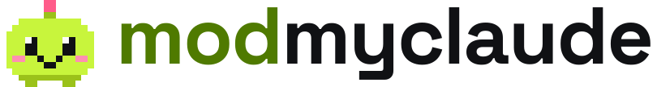

<div align="center">

<picture>
  <source media="(prefers-color-scheme: dark)" srcset="brand/logo-on-dark.svg">
  
</picture>

### Level up Claude Code with tested mods for safer runs, smarter spending and more fun.

Claude Code mods with <!-- tests -->3,200+<!-- /tests --> behaviour tests, terminal and desktop.

<!-- badges:start -->
[](https://github.com/modmyclaude/claude-code-mods/actions/workflows/check.yml)
[](#the-mods)
[](CONTRIBUTING.md#the-bar)
[](#install)
[](LICENSE)
<!-- badges:end -->

<!-- hero: a 6-10 second clip goes here -->

</div>

```
/plugin marketplace add modmyclaude/claude-code-mods
/plugin install thermostat@modmyclaude
```

Needs Claude Code 2.1.287+. Terminal or the desktop app's Code tab.

[**Browse the mods**](#the-mods) · [Website](https://modmyclaude.com) · [Build your own](#build-your-own) · [Safety](#safety) · [FAQ](#faq)

## What is a mod?

Mods are Claude Code plugins written in TypeScript, new in Claude Code 2.1.287. A mod can draw inside Claude Code (a band above the prompt, a pane beside the chat, the status line), react to your prompts and Claude's tool calls, and add slash commands. You install one with a single command, and it runs in the terminal and in the desktop app's Code tab.

This repo is a small, curated collection of <!-- count -->17<!-- /count --> of them, plus the prompts that built each one.

## Why these mods

- **Tested where you use it.** <!-- tests -->3,200+<!-- /tests --> behaviour tests run in Claude Code's own test kit, on the terminal and the desktop app, not only a static validate.
- **Built here.** Not a list of other people's repos.
- **Reviewed by a second builder.** No mod is listed on its builder's word alone.
- **Honest badges.** What each mod can touch comes from Claude Code's own validator, not from our description.

## Install

Update first if you need to (`claude update`), then in a Claude Code session:

```
/plugin marketplace add modmyclaude/claude-code-mods
/plugin install <mod>@modmyclaude
```

Or in one line, which adds the marketplace on first use:

```
/plugin install <mod> --marketplace modmyclaude/claude-code-mods
```

A mod is active as soon as it installs, with no restart. Installs at user scope (the default) also load in the desktop app's Code tab. The VS Code extension does not draw mods yet.

## The mods

<!-- catalogue:start -->
### Safety

| | Mod | What it does | Can reach |
|---|---|---|---|
|  | [**Cloakroom**](mods/cloakroom)<br>`cloakroom@modmyclaude` | Check your secrets at the door. Claude gets a ticket; the real value only comes back where you allow it. [Prompt](prompts/cloakroom.md) | `writes files` `reads files` `hooks tool calls` `hooks prompts` |
|  | [**Last Look**](mods/last-look)<br>`last-look@modmyclaude` | Holds destructive commands until you approve, and shows what they would destroy. [Prompt](prompts/last-look.md) | `reads files` `runs commands` `hooks tool calls` |

### Cost and limits

| | Mod | What it does | Can reach |
|---|---|---|---|
|  | [**Redline**](mods/redline)<br>`redline@modmyclaude` | Context fill, session cost and pace on one line, with a warning before the red line. [Prompt](prompts/redline.md) | `display only` |
|  | [**Thermostat**](mods/thermostat)<br>`thermostat@modmyclaude` | Shows when your prompt cache goes cold, and stops the expensive send. [Prompt](prompts/thermostat.md) | `calls a model` `hooks prompts` |

### See what Claude is doing

| | Mod | What it does | Can reach |
|---|---|---|---|
|  | [**Ant Farm**](mods/ant-farm)<br>`ant-farm@modmyclaude` | Watch your subagents work, and what they cost, live. [Prompt](prompts/ant-farm.md) | `display only` |
|  | [**Footprints**](mods/footprints)<br>`footprints@modmyclaude` | A live file tree beside the chat that shows where Claude has been. [Prompt](prompts/footprints.md) | `reads files` `runs commands` `hooks tool calls` |
|  | [**Headway**](mods/headway)<br>`headway@modmyclaude` | See how far along Claude is, and when it will land. [Prompt](prompts/headway.md) | `hooks tool calls` |

### Review changes

| | Mod | What it does | Can reach |
|---|---|---|---|
|  | [**Play-by-Play**](mods/play-by-play)<br>`play-by-play@modmyclaude` | Replays every change Claude made in a turn, shell edits included. [Prompt](prompts/play-by-play.md) | `runs commands` `hooks tool calls` |

### Catch what you would miss

| | Mod | What it does | Can reach |
|---|---|---|---|
|  | [**Fine Print**](mods/fine-print)<br>`fine-print@modmyclaude` | A second reader that flags what you would miss in a wall of text. [Prompt](prompts/fine-print.md) | `calls a model` |

### Memory

| | Mod | What it does | Can reach |
|---|---|---|---|
|  | [**Noted**](mods/noted)<br>`noted@modmyclaude` | Turns your corrections into permanent rules, without duplicates. [Prompt](prompts/noted.md) | `writes files` `reads files` `calls a model` `hooks prompts` |

### Workflow

| | Mod | What it does | Can reach |
|---|---|---|---|
|  | [**Crossroads**](mods/crossroads)<br>`crossroads@modmyclaude` | Three ways forward after every turn, risky ones marked. About $0.0002 a turn. [Prompt](prompts/crossroads.md) | `calls a model` `hooks prompts` |
|  | [**Porthole**](mods/porthole)<br>`porthole@modmyclaude` | A live preview of the app you are building, right beside the chat. [Prompt](prompts/porthole.md) | `reads files` `runs commands` `hooks tool calls` |

### Alerts

| | Mod | What it does | Can reach |
|---|---|---|---|
|  | [**Pager**](mods/pager)<br>`pager@modmyclaude` | Plays a sound when Claude finishes, needs you or hits an error. [Prompt](prompts/pager.md) | `network` `plays sound` |

### Looks

| | Mod | What it does | Can reach |
|---|---|---|---|
|  | [**Wardrobe**](mods/wardrobe)<br>`wardrobe@modmyclaude` | Restyle Claude Code live, including colourblind-safe and high-contrast themes. [Prompt](prompts/wardrobe.md) | `hooks tool calls` |

### Fun

| | Mod | What it does | Can reach |
|---|---|---|---|
|  | [**Halftime**](mods/halftime)<br>`halftime@modmyclaude` | Claude works, you play. The whistle blows the moment it needs you. [Prompt](prompts/halftime.md) | `hooks tool calls` |
|  | [**Hatchling**](mods/hatchling)<br>`hatchling@modmyclaude` | A collectible pixel pet that hatches, reacts and evolves while you code. [Prompt](prompts/hatchling.md) | `hooks tool calls` |

### Wellness

| | Mod | What it does | Can reach |
|---|---|---|---|
|  | [**Second Wind**](mods/second-wind)<br>`second-wind@modmyclaude` | A breath, an eye rest or a stretch while Claude works, sized to the wait. [Prompt](prompts/second-wind.md) | `hooks prompts` |
<!-- catalogue:end -->

## Build your own

- **[Mod Maker](prompts/starters/mod-maker.md)**: describe the feature you wish Claude Code had, and get a tested, installable mod.
- **[Mod Matchmaker](prompts/starters/mod-matchmaker.md)**: Claude checks your setup and picks the mods worth installing, in order.

Every mod here started as a prompt in [prompts/](prompts). Open one, change a line, and paste it into Claude Code to build your own version.

## Safety

Mods are not sandboxed: a mod runs with your permissions and can see your prompts and tool calls. That is why this collection is small and checked:

- Each mod is reviewed by a second builder against its prompt before it is listed.
- The "Can reach" column comes from `claude plugin validate`, so a mod that reads files, runs commands, calls a model or uses the network says so.
- Mods that call a model say so, use a small model and cap how often they call it.
- Guards that can stop an action fail safe: if the mod itself breaks, it does not silently let the action through.
- Safety mods are a safety net, not a permission system. Keep using Claude Code's own permission settings.

Found a problem? See [SECURITY.md](SECURITY.md).

## FAQ

<details>
<summary><b>Which mods should I start with?</b></summary>

Paste the [Mod Matchmaker](prompts/starters/mod-matchmaker.md) prompt into Claude Code and it picks for your setup. Or start with **Redline** (a context and cost gauge) and **Headway** (progress and an ETA): neither calls a model.

</details>

<details>
<summary><b>Do mods cost tokens?</b></summary>

Only the ones with the `calls a model` badge, and each says how often in its README. Those calls run on your account and use a small model. Every other mod makes no model calls at all.

</details>

<details>
<summary><b>How do I change a mod's settings?</b></summary>

Mods with options show them in `/config` and when you enable the plugin. Each mod's README lists its settings and defaults. From a shell, `claude plugin configure <mod>@modmyclaude` shows which are set.

</details>

<details>
<summary><b>How do I update, turn off or remove a mod?</b></summary>

```bash
claude plugin marketplace update modmyclaude   # fetch the latest catalogue
claude plugin update <mod>@modmyclaude         # then /reload-plugins in a running session
claude plugin disable <mod>@modmyclaude        # keep it installed but off
claude plugin uninstall <mod>@modmyclaude      # remove it
```

The `/plugin` menu inside a session does the same.

</details>

<details>
<summary><b>Does it work in the desktop app and VS Code?</b></summary>

Every mod is tested on the terminal and the desktop app's Code tab. The VS Code extension does not draw mods yet, so mods with a band or pane show nothing there.

</details>

<details>
<summary><b>Is this made by Anthropic?</b></summary>

No. This is an independent community project. It uses only Claude Code's mods API, which is in early access and may change.

</details>

## Contributing

Ideas and new mods are welcome. Open a [Mod idea](https://github.com/modmyclaude/claude-code-mods/issues/new?template=mod-idea.yml) issue first, then read [CONTRIBUTING.md](CONTRIBUTING.md) for the bar every mod meets. Please follow the [Code of Conduct](CODE_OF_CONDUCT.md).

---

<div align="center">

Not affiliated with or endorsed by Anthropic. Claude and Claude Code are trademarks of Anthropic, PBC. [MIT License](LICENSE).

</div>
