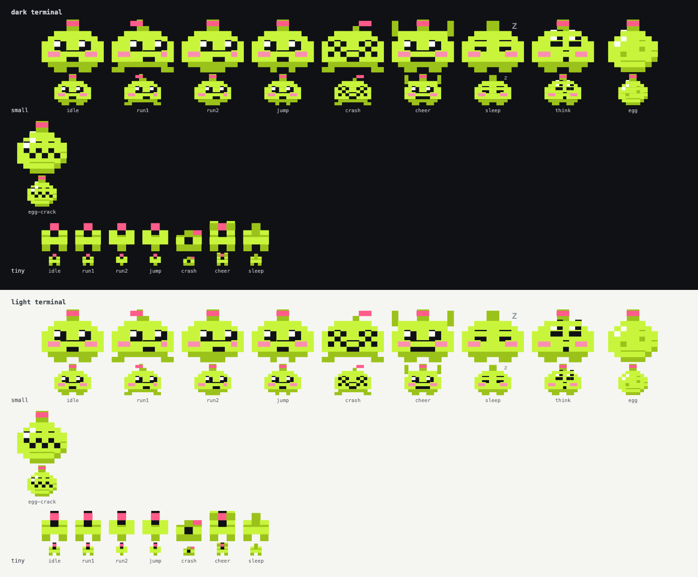

# Bolt sprites

Bolt, the modmyclaude mascot, drawn small enough to live inside a mod: in panes, empty states, result lines and game
boards. Every sprite is half-block text cells (two pixel rows per cell), so it draws in the terminal and in the desktop
app's code-font cell grid.



## Sizes and poses

| Size | Pixels | Cells (cols x rows) | Use | Poses |
| --- | --- | --- | --- | --- |
| `small` | 10 x 10 | 10 x 5 | panes, empty and first-run states, result lines | idle, run1, run2, jump, crash, cheer, sleep, calm, sweat, think, egg, egg-wobble-l, egg-wobble-r, egg-crack-1, egg-crack-2, egg-crack-3, egg-hatch |
| `tiny` | 3 x 4 | 3 x 2 | game runners, inline status | idle, run1, run2, jump, crash, cheer, sleep |

Run is two frames (`run1`, `run2`, exported as `BOLT_RUN`): swap them about every 120 ms.

The egg set is Bolt's lime and antenna light on an egg, for hatchling:
- `egg-wobble-l` and `egg-wobble-r` (a 1 px lean) wobble while Claude works.
- `egg-crack-1`, `egg-crack-2` and `egg-crack-3` show the crack growing at about 25, 50 and 75 percent.
- `egg-hatch` lifts the lid off an empty shell, just before the pet appears.

`calm` (eyes closed, light on, no z) is for breathing and resting on purpose. `sleep` (light off, z) is for idle and cold.

`sweat` (a grey drop beside the head) is the gentle reaction to a failed tool. Use `crash` only for a game crash.

## Files

| File | What it is |
| --- | --- |
| `bolt-sprites.json` | Source of truth for any language: the palette, sizes, and per sprite the pixel `rows` plus pre-packed `cells` (`ch`, `fg`, `bg`). |
| `bolt.ts` | A copy-in TypeScript module: `boltCells(size, pose)` returns the cells, `boltRuns(line)` merges them into coloured Text runs. Strict-mode clean. |
| `preview.png` | Every pose on a dark and a light terminal background. |
| `tools/` | `design.py` (the drawings), `build.py` (validates, then writes the JSON and `bolt.ts`), `preview.py`. |

Mods install on their own, so a mod cannot import from `brand/`: copy `bolt.ts` into your mod's `hooks/` folder.

## Drawing it

- **Terminal:** draw the cells with one `Raster`. hatchling's `rasterCells` packs `BoltCell[][]` straight in.
- **Desktop:** one fixed-width cell per character (Box width 1), as halftime does. A missing `fg` or `bg` means
  the surface's own colour, so the sprite sits on any background.
- **Coloured Text:** `boltRuns(line)` gives one span per colour run.

## Rules

From `brand/BRAND.md`, enforced by `build.py`:

- **Colours stay put.** Pink is the antenna light only, and blush is the cheeks only. Never recolour, rotate, stretch or
  outline Bolt.
- **Ink stays inside.** Eyes, mouth and cracks always sit inside a lime shape, so they never vanish on a dark terminal.
- **Every awake pose shows the antenna light.** When Bolt sleeps, the light is off.
- **Grey is for the sleep z and the sweat drop only.**
- **Bolt never covers a safety hold** (last-look, cloakroom), and never appears in a toast, because toasts are uncoloured
  text.
- **No emoji next to Bolt** in product copy.

## Changing a sprite

Edit `tools/design.py`, then from the repo root:

```
python3 -I brand/bolt-sprites/tools/build.py
python3 -I brand/bolt-sprites/tools/preview.py /tmp/bolt-preview.html
```

`build.py` refuses a sprite that breaks the rules above. Re-copy `bolt.ts` into any mod that uses it.
